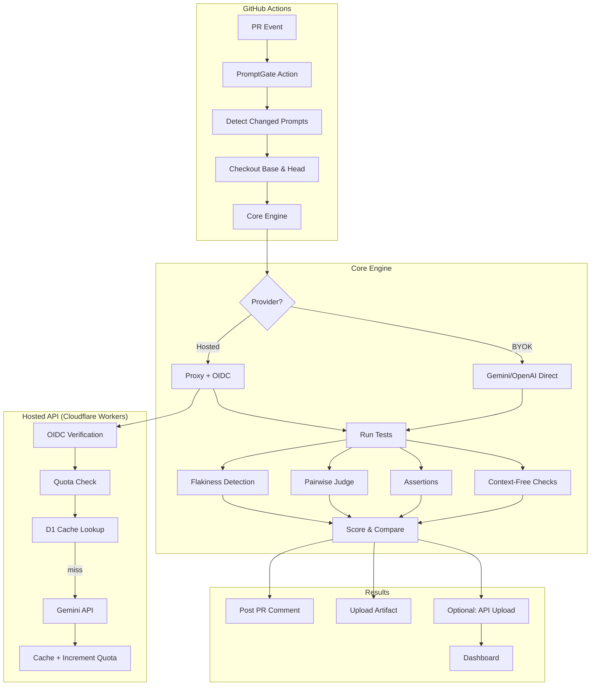

# ⚡ PromptGate

**Catch LLM prompt regressions before they merge.**

PromptGate is an open-source CI evaluation gate for LLM prompts. When a pull request changes a prompt, it runs the old (base) and new (PR) versions against a test set, scores them with multiple layers including pairwise LLM judging, and posts a clear comparison comment. If the new version regresses, the check fails.

[](https://github.com/ekansh2112/promptgate/actions)
[](https://opensource.org/licenses/MIT)

---

## 🎯 The Problem

LLM prompts are code. They evolve, break, and need testing just like any other logic. But unlike traditional code:
- **Outputs are non-deterministic** — the same prompt can produce different results
- **Quality is subjective** — "better" depends on context, not just correctness
- **Changes are subtle** — a small wording tweak can cause major behavioral shifts
- **Manual review is slow** — reviewing dozens of outputs per change doesn't scale

PromptGate solves this by automating prompt evaluation in CI with:
- **Pairwise LLM judging** that compares base vs PR outputs side-by-side
- **Position bias cancellation** (runs both A→B and B→A, requires agreement)
- **Flakiness detection** (runs each test N times to catch non-deterministic behavior)
- **Multi-layer scoring** (assertions, context-free checks, judge + rubric)
- **Judge calibration** (track human vs judge agreement to measure reliability)

---

## 📊 Sample PR Comment

<!-- Real comment will be inserted here after dogfooding PR #2 -->

Here's what PromptGate posts on your pull requests:

```markdown
## ✅ PromptGate Evaluation PASSED

**Base:** `a3f2c1b` | **Head:** `d7e9f8a`

### Code Review Summary

| Metric | Base | Head | Delta |
|--------|------|------|-------|
| Pass Rate | 100.0% | 100.0% | ➡️ +0.0% |
| Avg Latency | 842ms | 798ms | -44ms |
| Cost | $0.0012 | $0.0013 | $0.0001 |

### Bug Report Classification

| Metric | Base | Head | Delta |
|--------|------|------|-------|
| Pass Rate | 80.0% | 100.0% | 📈 +20.0% |
| Avg Latency | 623ms | 611ms | -12ms |
| Cost | $0.0015 | $0.0016 | $0.0001 |

🎲 **1 flaky case(s)** (non-deterministic outputs)

**Total Cost:** $0.0056
**Judge Calibration:** 85.0% agreement (5 labeled cases)

_Evaluated at 10/26/2026, 7:30:15 PM_
```

When a regression is detected, the check fails and the comment includes:
- Side-by-side output comparison for regressed cases
- Judge reasoning for why base was preferred
- Critical failure indicators

## 🌐 Live Services

- **Dashboard:** https://promptgate-dashboard.pages.dev
- **API:** https://promptgate-api.ekansh-gupta.workers.dev
- **API Health:** https://promptgate-api.ekansh-gupta.workers.dev/health

**Note:** v1 dashboard OAuth is `read:user` scope only, so it supports **public repositories only**. For private repositories, use BYOK (bring your own key) mode in the GitHub Action. Full private repository support with dashboard access is planned for v2.

---

## 🚀 Quick Start

### 1. Add the workflow

Create `.github/workflows/promptgate.yml`:

```yaml
name: PromptGate

on:
  pull_request:

permissions:
  contents: read
  pull-requests: write
  id-token: write  # For hosted mode (optional)

jobs:
  eval:
    runs-on: ubuntu-latest
    steps:
      - uses: actions/checkout@v4
        with:
          fetch-depth: 0

      - uses: ekansh2112/promptgate@v1
        with:
          config: promptgate.yaml
        env:
          GITHUB_TOKEN: ${{ secrets.GITHUB_TOKEN }}
          # BYOK (recommended for production):
          GEMINI_API_KEY: ${{ secrets.GEMINI_API_KEY }}
          # Or use hosted mode (see below)
```

### 2. Create your config

`promptgate.yaml`:

```yaml
prompts:
  - name: "User greeting"
    path: "prompts/greeting.txt"
    model: "gemini-2.0-flash-exp"
    variables: ["user_name"]
    testSet: "tests/greeting.yaml"
    rubric: "Should be friendly, personalized, and under 50 words."
    temperature: 0.7
```

### 3. Write test cases

`tests/greeting.yaml`:

```yaml
- name: "Basic greeting"
  inputs:
    user_name: "Alice"
  assertions:
    - type: contains
      value: "Alice"
    - type: length_max
      value: 200

- name: "Empty name"
  inputs:
    user_name: ""
  critical: true
  assertions:
    - type: not_contains
      value: "undefined"
```

### 4. Commit and open a PR

PromptGate will:
1. Detect which prompts changed
2. Run base and head versions against test cases
3. Compare outputs with assertions + LLM judge
4. Post results as a PR comment
5. Pass or fail the check

---

## 📋 Configuration Reference

### Prompt Config

```yaml
prompts:
  - name: "Human-readable name"
    path: "path/to/prompt.txt"          # Prompt template file
    model: "gemini-2.0-flash-exp"        # LLM model to use
    variables: ["var1", "var2"]          # Variables in {{brackets}}
    testSet: "path/to/tests.yaml"        # Test cases file
    rubric: "Quality criteria..."        # Optional: for LLM judge
    temperature: 0.7                     # Optional: 0.0-2.0
    maxTokens: 500                       # Optional: output limit
    systemPrompt: "You are..."           # Optional: system message
```

### Test Set Format

```yaml
- name: "Test case name"
  inputs:
    variable_name: "value"
  critical: true                         # Optional: fail fast if this regresses
  assertions:                            # Optional: structured checks
    - type: contains
      value: "expected substring"
    - type: json_equals
      path: "field.nested"
      value: 42
```

### Assertion Types

| Type | Description | Parameters |
|------|-------------|------------|
| `contains` | Output must contain substring | `value` |
| `not_contains` | Output must NOT contain substring | `value` |
| `regex` | Output must match pattern | `pattern` |
| `json_equals` | JSON field must equal value | `path`, `value` |
| `json_in` | JSON field must be in list | `path`, `values` |
| `length_min` | Output length ≥ N | `value` |
| `length_max` | Output length ≤ N | `value` |

### Scoring Config

```yaml
scoring:
  runs: 3                       # How many times to run each test (for flakiness)
  passRateThreshold: 0.1        # Max allowed pass rate drop (0.1 = 10%)
  enableCache: true             # Cache LLM responses by hash
```

---

## 🧠 How Scoring Works

PromptGate evaluates prompts with **four layers**:

### 1️⃣ Context-Free Checks
Automated, fast checks on the raw output:
- Valid JSON (if expected)
- Refusal detected (content filter triggered)
- Error or timeout
- Output length
- Latency
- Cost (token-based estimate)

### 2️⃣ Assertions
Structured rules you define per test case:
- String matching (`contains`, `not_contains`, `regex`)
- JSON validation (`json_equals`, `json_in`)
- Length constraints (`length_min`, `length_max`)

### 3️⃣ Pairwise LLM Judge
When a rubric is provided, PromptGate uses an LLM to compare base vs head outputs:
- Calls the judge twice: once as `(base, head)` and once as `(head, base)`
- If both judges agree after reversing positions → use that result
- If they disagree → **tie** (position bias detected, no clear winner)

This bidirectional approach cancels position bias (LLMs often prefer the first option they see).

Judge prompt includes:
- Your rubric
- The prompt being evaluated
- Test case inputs
- Both outputs to compare

### 4️⃣ Flakiness Detection
Each test runs **N times** (default 3):
- If outputs differ across runs → **flaky** 🎲
- High flakiness = unreliable prompt (temperature too high, underspecified task)
- Reported separately so you can investigate

### Pass/Fail Logic
A prompt **fails** if:
- Any **critical** test case regresses (head worse than base)
- Pass rate drops more than `passRateThreshold` (default 10%)

### Judge Calibration
You can label outputs as "good" or "bad" (via dashboard or YAML file). PromptGate reports **judge vs human agreement** as a percentage. Use this to:
- Detect when the judge is unreliable
- Improve your rubric
- Track evaluation quality over time

---

## 🔑 Hosted Mode vs BYOK

### Hosted Mode (Free Tier)
If no API key is provided, PromptGate routes LLM calls through `promptgate-api.ekansh-gupta.workers.dev`:
- ✅ Zero setup — just add the Action
- ✅ Daily quotas: 1,000 calls, 500k tokens, $50 global budget
- ✅ Only cheap models allowed (`gemini-2.0-flash-exp`, `gemini-1.5-flash`, `gemini-1.5-flash-8b`)
- ✅ Response caching (saves quota)
- ⚠️ **Google's free tier policy**: prompts may be used to improve Gemini
- ⚠️ Fork PRs can't use hosted mode (no OIDC token)

When quota is reached, the check **fails with a clear message**: "Add your own API key to continue."

**Recommendation:** Hosted mode is perfect for trying PromptGate. For production or sensitive prompts, use BYOK.

### BYOK (Bring Your Own Key)
Add `GEMINI_API_KEY` or `OPENAI_API_KEY` to your repository secrets:
- ✅ No quotas (you control spend)
- ✅ Privacy: your prompts never leave your account
- ✅ Any model supported by the provider
- ✅ Works on fork PRs

**OpenAI-compatible endpoints:**
```yaml
env:
  OPENAI_API_KEY: ${{ secrets.OPENAI_API_KEY }}
  OPENAI_BASE_URL: https://api.groq.com/v1  # Optional
```

---

## 🏗️ Architecture



### Components

| Package | Description |
|---------|-------------|
| **`packages/core`** | Engine library + CLI (`promptgate init`) |
| **`packages/action`** | GitHub Action wrapper (Node 20, bundled with esbuild) |
| **`apps/api`** | Cloudflare Worker (Hono + D1) for hosted mode + dashboard backend |
| **`apps/dashboard`** | React + Vite dashboard (Cloudflare Pages) |
| **`examples/`** | Sample prompts/tests for dogfooding |

---

## 🆚 Comparison with Existing Tools

| Feature | PromptGate | promptfoo | OpenAI Evals | LangSmith |
|---------|-----------|-----------|--------------|-----------|
| **CI-native** | ✅ GitHub Action | ⚠️ CLI only | ⚠️ CLI only | ❌ Dashboard-first |
| **Pairwise judging** | ✅ With bias cancellation | ✅ | ❌ | ✅ |
| **Flakiness detection** | ✅ Multi-run + variance | ❌ | ❌ | ❌ |
| **Hosted mode** | ✅ Free tier | ❌ | ❌ | ✅ Paid |
| **PR comments** | ✅ Auto-posted | ❌ | ❌ | ❌ |
| **Pass/fail gate** | ✅ Built-in | ⚠️ Manual | ⚠️ Manual | ⚠️ Manual |
| **Open source** | ✅ MIT | ✅ MIT | ✅ MIT | ❌ Proprietary |
| **Judge calibration** | ✅ Track agreement | ❌ | ❌ | ✅ |
| **Cost tracking** | ✅ Per-run | ✅ | ❌ | ✅ |

**Key differentiators:**
- **PromptGate is designed for CI**: one Action, zero config, automated PR feedback
- **Pairwise judging with bias cancellation**: more reliable than single-pass evaluation
- **Flakiness as a first-class metric**: helps you catch non-deterministic prompts early
- **Hosted mode**: try it instantly without API keys

**When to use promptfoo instead:**
- You need more complex evaluation scenarios (agents, multi-turn, custom providers)
- You prefer local-first CLI workflows over CI automation

**When to use LangSmith instead:**
- You need production tracing and observability (PromptGate is eval-only)
- You're already deep in the LangChain ecosystem

---

## 🧪 CLI Usage

### Generate test cases for an existing prompt

```bash
export GEMINI_API_KEY=your_key_here
npx @promptgate/core init prompts/my-prompt.txt -o tests/
```

This creates:
- `tests/my-prompt.testset.yaml` — 5 diverse test cases
- `tests/my-prompt.rubric.txt` — suggested evaluation rubric

Review and edit both files before using them in production.

---

## 🔧 Development

```bash
# Install dependencies
pnpm install

# Build all packages
pnpm build

# Run tests
pnpm test

# Type check
pnpm typecheck

# Lint
pnpm lint

# Run Worker locally
cd apps/api
pnpm dev

# Run Dashboard locally
cd apps/dashboard
pnpm dev
```

### Testing the Action locally

```bash
# Build the Action
cd packages/action
pnpm build

# Commit dist/ (required for GitHub Actions)
git add dist/
git commit -m "Build action"

# Use in a test workflow
uses: ./
```

---

## 📦 After Merge: Publishing v1

Once this PR merges to `main`, create the `v1` tag so users can reference `ekansh2112/promptgate@v1`:

```bash
git checkout main
git pull
git tag -a v1 -m "Release v1.0.0"
git push origin v1

# Also create a v1.0.0 release on GitHub for discoverability
gh release create v1.0.0 --title "v1.0.0" --notes "Initial release of PromptGate"
```

**Subsequent updates:**
- For patches/features: move the `v1` tag forward (`git tag -fa v1 -m "Update v1"`)
- For breaking changes: create `v2`, `v3`, etc.

The Action's `dist/index.js` is committed so users don't need to build it. Always rebuild before merging:

```bash
cd packages/action
pnpm build
git add dist/
```

---

## 📜 License

MIT © 2026 Ekansh Gupta

---

## 🙏 Acknowledgments

Built with:
- [Turborepo](https://turbo.build/) for monorepo management
- [Hono](https://hono.dev/) for the API
- [Cloudflare Workers](https://workers.cloudflare.com/) & [D1](https://developers.cloudflare.com/d1/) for hosting
- [Gemini](https://ai.google.dev/) for LLM inference
- [Vitest](https://vitest.dev/) for testing
- [Zod](https://zod.dev/) for schema validation

Inspired by [promptfoo](https://github.com/promptfoo/promptfoo) and the broader LLM evaluation ecosystem.

---

**Questions?** Open an issue or discussion on [GitHub](https://github.com/ekansh2112/promptgate).
